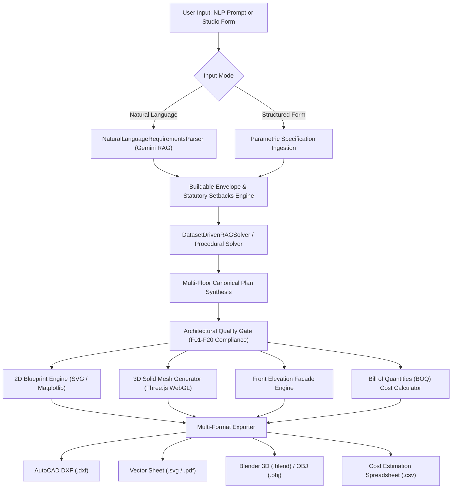

# AI Driven Building Architectural Design System

[](https://www.python.org/)
[](https://www.blender.org/)
[](https://ezdxf.readthedocs.io/)
[](https://threejs.org/)
[](https://ai.google.dev/)
[](LICENSE)

An enterprise-grade, state-of-the-art **AI-Driven Building Architectural Design & Modeling System**. Generates physically viable, municipal-compliant residential floor plans, architectural front elevations, 3D WebGL / Blender models, and dynamic construction cost estimates (BOQ) from natural language prompts or structured form parameters.

---

## 🌟 Key Highlights & Capabilities

- 🗣️ **Dual Input Modality**:
  - **Natural Language (NLP) Prompt**: Free-form natural descriptions (e.g. *"5 Marla Spanish luxury villa with 4 bedrooms, drawing room, courtyard, double car porch, rooftop terrace"*).
  - **Architect Studio Form**: Precise parametric controls (plot frontage, depth, units, rectangular / corner / L-shape / irregular polygons, storeys G to G+2, room schedules, DHA/LDA municipal setbacks, and budget tiers).
- 📐 **2D Floor Plan Blueprint Canvas**:
  - Multi-storey layout generator (Ground Floor, First Floor, Rooftop Penthouse & Terrace).
  - Real-time interactive SVG vector blueprint with thick double-line walls, 90° door swing arcs, multi-line glazed windows, dogleg stairs with directional flow, furniture blocks (beds, sofas, dining, cars in porch), and dimension callouts.
  - Interactive layer toggles (Walls, Doors, Windows, Furniture, Dimension Lines, Room Area Tags).
- 🧊 **Interactive 3D Model Studio (WebGL & Blender 5.1)**:
  - Real-time **Three.js** 3D WebGL solid model viewport with orbital camera controls, realistic architectural materials (stucco, terracotta tiles, fair-face concrete, tinted glass).
  - **Exploded Axonometric View**: Vertical floor-by-floor expansion to inspect interior spatial adjacencies in 3D.
  - **Cutaway Roof View**: Instant cutaway to peer down into furnished rooms.
  - **Blender 5.1 Procedural Generator**: Direct compilation into native `.blend` files with solid walls, boolean void cutters, sun lamp rigs, and Cycles rendering.
- 🏛️ **Front Elevation & Facade Evaluation**:
  - Detailed 2D/3D architectural front elevation drawings displaying exact vertical datums (Road Level ±0', Plinth +2', Ground Ceiling +12', First Floor +23', Parapet +26'-6").
  - Automated Facade Evaluation Matrix: Golden Ratio adherence, aesthetic symmetry index, solar shading & climate response rating, and curb appeal score.
- 💰 **Comprehensive Cost Estimation Engine (BOQ)**:
  - Parametric Bill of Quantities calculating material quantities & costs in real-time across **PKR** (₨) and **USD** ($).
  - **Phase 1: Grey Structure**: Cement bags, Grade-60 steel rebar (tons), burnt red bricks, coarse sand (cft), aggregate crush, plinth beam & RCC slabs, electrical conduits & plumbing piping.
  - **Phase 2: Architectural Finishing**: Porcelain / marble tiles, solid wood doors, powder-coated aluminum/UPVC windows, sanitary ware & mixers, kitchen carpentry, paint & false ceilings.
  - **Milestone Payment Schedule**: Phased contractor payment timeline (Plinth 15%, Structure 25%, Masonry 20%, Finishing 30%, Handover 10%).
- 📚 **Architectural Templates Library**:
  - 8 curated, pre-engineered master templates (3 Marla Urban Compact, 5 Marla Spanish Hacienda, 5 Marla Contemporary, 7 Marla Duplex, 10 Marla Luxury Estate, 10 Marla Spanish Villa, 1 Kanal Neo-Classical Palace, Corner Plot Dual Frontage).
  - 1-click loading with complete layout, 3D geometry, and BOQ breakdown.
- 🔄 **Layout Regeneration & Iteration**:
  - 1-click "Regenerate Layout" yielding fresh topological room variations, staircase re-orientations, and circulation optimizations.
- 👤 **Account Management & Portfolio**:
  - User profiles (Lead Architect, Homeowner, Contractor, Developer).
  - Saved Design Portfolio with thumbnail cards, metadata, and instant re-loading.
  - Currency preferences (PKR, USD) and measurement units (Imperial ft vs Metric m).
- 📦 **Multi-Format Export Suite**:
  - **Floor Plan**: AutoCAD DXF (`.dxf` with AIA layers: `A-WALL`, `A-DOOR`, `A-WIND`, `A-DIMS`), Pure SVG (`.svg`), Presentation Sheet PDF (`.pdf`).
  - **3D Model**: Blender `.blend` model file, Wavefront 3D (`.obj`), and 3D printing (`.stl`).
  - **Cost Estimation**: Itemized Bill of Quantities (`.csv`).
  - **Specifications**: Architectural Brief & RAG Summary (`.txt`).
- 🛡️ **Automated Architectural Quality Gate**:
  - Strict compliance checks (F01-F20) enforcing envelope containment, zero negative coordinates, wet zone vertical alignment, staircase headroom clearances, and statutory municipal setbacks.

---

## 🏛️ System Architecture Workflow



---

## 🚀 Quick Start Guide

### 1. Prerequisites
- **Python**: 3.10 or higher
- **Node.js**: (Optional, system uses native Python web server)
- **Blender**: 4.x or 5.x installed at `C:\Program Files\Blender Foundation\Blender 5.1\blender.exe` (Optional, required for native `.blend` generation)

### 2. Installation
Clone the repository and install required Python packages:

```bash
git clone https://github.com/<your-username>/AI-Driven-Building-Architectural-Design-System.git
cd "AI-Driven-Building-Architectural-Design-System"
pip install -r requirements.txt
```

### 3. Launch the Web Studio
To start the interactive web application:

```bash
python run_app.py
```
*Or on Windows, simply double-click **`start_system.bat`**.*

The browser will automatically open at:
👉 **`http://127.0.0.1:8000`**

---

## 🖥️ Web Application Interface Overview

| Feature View | Description | Key Controls |
| :--- | :--- | :--- |
| **NLP Prompt Studio** | Natural language free-text input with instant intent recognition | Chips, Live tags, Generate button |
| **Architect Studio Form** | Parametric site dimensions, setbacks, storeys, and room counters | Width, Depth, Setbacks, Rooms |
| **2D Blueprint Studio** | CAD-grade SVG vector blueprint viewer | Layer toggles, Zoom/Fit, Floor levels |
| **3D Interactive Studio** | WebGL solid house rendering with materials & shadows | Orbit, Exploded view, Roof cutaway |
| **Front Elevation Studio**| Facade design, height markers, and aesthetic evaluation matrix | Style palette, Golden ratio, Shading |
| **Cost Estimation (BOQ)** | Dynamic material breakdown, unit rates, and contractor milestones | Tier switcher, Currency, CSV export |
| **Templates Library** | 8 pre-engineered architectural master templates | 1-Click Load into Studio |
| **Export Suite** | Instant download center for all CAD and 3D files | DXF, SVG, PDF, BLEND, OBJ, CSV |

---

## 🛠️ Command-Line Interface (CLI)

You can also run the master architectural pipeline directly from the command line:

```bash
# Generate complete package from an architectural prompt
python pipeline_runner.py generate --prompt "5 Marla Spanish house with 4 beds" --outdir "output/my_house" --format all

# Generate layout for irregular / non-orthogonal site
python pipeline_runner.py generate --prompt "Modern residence" --shape corner_plot --sides "32,50,15" --outdir "output/corner_house"

# Ingest and convert AutoCAD DXF to Canonical Architectural JSON
python pipeline_runner.py dxf-to-canonical --file "path/to/blueprint.dxf" --outdir "output/dxf_canonical"
```

---

## 📂 Project Structure

```text
├── api_server.py                 # Master API & HTTP Web Server (REST Endpoints)
├── run_app.py                    # Launcher orchestrator (opens default browser)
├── start_system.bat              # Windows 1-click startup script
├── pipeline_runner.py            # Master CLI Pipeline Orchestrator
├── requirements.txt              # Production Python dependencies
├── web/                          # Web Studio Frontend Application
│   ├── index.html                # Single-page architectural studio application
│   ├── styles.css                # Luxury dark blueprint CAD design system
│   └── app.js                    # 2D/3D rendering, state management, & export engine
├── generation/                   # Layout synthesis & algorithmic solvers
│   ├── rag_solver.py             # Dataset-driven RAG layout synthesis engine
│   ├── solver.py                 # CP-SAT constraint satisfaction layout solver
│   ├── quality_gate.py           # Automated F01-F20 architectural compliance auditor
│   ├── visualizer.py             # Publication-quality 2D drawing & vector sheet renderer
│   ├── architectural_styles.py   # Style engine (Spanish, Modern, Classical)
│   └── gemini_service.py         # Google Gemini AI reasoning & prompt parser
├── cad/                          # Computer-Aided Design (CAD) engines
│   ├── dxf_generator.py          # Layered AutoCAD DXF exporter (AIA Standards)
│   ├── parser.py                 # AutoCAD DXF vector ingestion engine
│   └── asset_loader.py           # Architectural CAD furniture & symbol loader
├── three_d/                      # 3D modeling & procedural rendering
│   ├── blender_generator.py      # Headless Blender 5.1 solid generator
│   └── blender_arch_v2_worker.py # Procedural wall extrusion & boolean void cutter
├── dataset/                      # Verified architectural layouts & RAG indexes
│   ├── dataset_index.json        # Vector index for layout retrieval
│   └── schema/canonical.py       # Pydantic CanonicalFloorPlan schema
├── output/                       # Generated blueprints, DXFs, and 3D models
└── tests/                        # Comprehensive unit and integration test suite
```

---

## 📐 Export Formats Specification

- **AutoCAD DXF (`.dxf`)**: Strict adherence to American Institute of Architects (AIA) CAD Layer Guidelines (`A-WALL-EXTR`, `A-WALL-INTR`, `A-DOOR`, `A-GLAZ`, `A-STRS`, `A-FURN`, `A-ANNO-TEXT`, `A-ANNO-DIMS`, `A-COLS`).
- **Vector Sheet (`.svg`)**: 1200x900 presentation sheet with border frame, title block, scale notation, and room labels.
- **Architectural PDF (`.pdf`)**: Vector presentation sheet suitable for Arch D (24"x36") or A3 printing at 300 DPI.
- **Blender 3D (`.blend`)**: Procedural mesh geometry with materials, sun lighting, and camera ready for Cycles rendering.
- **Wavefront 3D (`.obj`)**: Universal 3D mesh format with vertices and face definitions for 3ds Max, Maya, Rhino, SketchUp, and Unreal Engine.
- **Cost Estimation (`.csv`)**: Itemized Bill of Quantities spreadsheet with material volumes, costs, and payment milestones.

---

## 👥 Author & Acknowledgements

- **Lead Architect & Developer**: Saad Ali ([saadaliqureshi117@gmail.com](mailto:saadaliqureshi117@gmail.com))
- **Powered by**: Google Gemini AI & DeepMind Agentic Coding Framework
- **CAD & 3D Core**: `ezdxf`, `shapely`, `ortools`, `Three.js`, `Blender 5.1`

---

## 📄 License

This project is licensed under the MIT License - see the [LICENSE](LICENSE) file for details.
