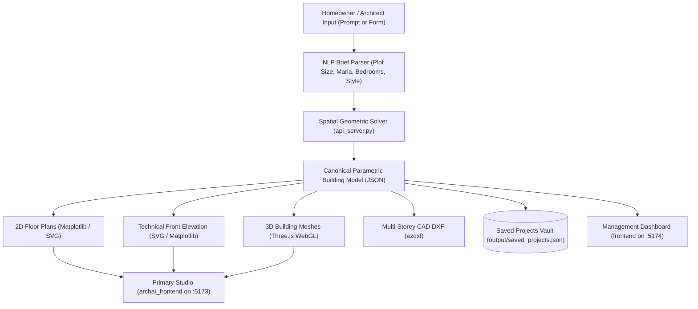

# AI-Driven Pakistani Residential Architectural CAD System
## Comprehensive Technical Architecture & Engineering Guide (For Gemini & Developers)

---

## 1. System Vision & Overview

This system is an AI-driven residential architectural CAD and BIM application tailored specifically to **Pakistani residential plot topologies and building bylaws** (e.g., 3 Marla, 5 Marla, 7 Marla, 10 Marla, and 1 Kanal).

The core technical philosophy of the platform is **single-source-of-truth parametric generation**:
Instead of generating 2D floor plans, 3D views, and elevations independently (which causes disconnected windows, misaligned walls, and unbuildable models), the platform synthesizes a **canonical spatial model** first. From this single mathematical representation, the system derives:
1. **Dimensioned 2D Blueprints** (Floor plans with doors, windows, furniture, and OTS lightwells).
2. **Technical Front Elevation** (1:1 aligned fenestration cutouts, datum markers, and porch columns).
3. **Interactive 3D WebGL Model** (Volumetric masses, floor slabs, open porches, and roof parapets).
4. **AutoCAD DXF Exports** (Layer-separated CAD drawings compatible with AutoCAD R2000+).



---

## 2. Backend Architecture (`api_server.py`)

* **Technology**: Python 3 (`http.server` base), Shapely, Matplotlib (Agg headless), `ezdxf`, Google Gemini API.
* **Port**: Runs on `http://127.0.0.1:8000`.

### A. Core Modules in `api_server.py`
1. **Natural Language Processing & Brief Parsing**:
   - Parses natural-language homeowner briefs (e.g., *"5 Marla Modern contemporary house 25x45 with 4 bedrooms, open kitchen, and car porch"*).
   - Maps Pakistani plot vernacular:
     - 3 Marla: $20.0' \times 34.0'$ ($680\text{ sq ft}$)
     - 5 Marla: $25.0' \times 45.0'$ ($1,125\text{ sq ft}$)
     - 7 Marla: $30.0' \times 52.5'$ ($1,575\text{ sq ft}$)
     - 10 Marla: $35.0' \times 65.0'$ ($2,275\text{ sq ft}$)
     - 1 Kanal: $50.0' \times 90.0'$ ($4,500\text{ sq ft}$)

2. **Parametric Spatial Solver & Bylaw Engine**:
   - Enforces Pakistani municipal setback requirements:
     - Front Setback: $5.0'$ to $10.0'$ (mandatory open car porch / front lawn).
     - Rear Setback: $3.0'$ to $7.0'$ (rear ventilation duct / wash area).
     - Side Boundary Party Lines: Zero setbacks on narrow plots ($<35'$ width); left and right walls are shared party walls with no exterior windows.
   - **Tripartite Cultural Zoning**:
     - *Public Zone (Front)*: Car Porch, Powder Room, and Guest Drawing Room with direct entrance.
     - *Semi-Private Zone (Center)*: Family TV Lounge, Dining Area, and Staircase Hall.
     - *Private Zone (Rear)*: Master & Family Bedrooms with attached ensuite bathrooms.
   - **OTS (Open-To-Sky) Ventilation Shafts**:
     - Narrow urban infill plots cannot place windows on side party walls.
     - The solver introduces interior lightwells / OTS courtyards so inner bedrooms and bathrooms receive legal natural ventilation and daylight.

3. **3D Volumetric Extrusion Generator**:
   - Converts 2D room polygons into 3D bounding geometry nodes (in meters for Three.js).
   - Generates:
     - Structural floor slabs ($0.2\text{m}$ thick concrete).
     - Ground-floor open car porch (open clearance with structural column posts).
     - First-floor cantilevered balcony boxes and glass railings.
     - Rooftop parapet walls ($3.5'$ height) and stair mumty towers.

4. **Multi-Storey CAD DXF Generator (`ezdxf`)**:
   - Produces clean AutoCAD R2000 drawings.
   - Exports floor levels side-by-side on standard architectural CAD layers:
     - `PLOT_BOUNDARY`, `WALLS`, `DOORS`, `WINDOWS`, `FURNITURE`, `ROOM_TAGS`, `STAIRCASES`, `OTS_SHAFTS`, `DIMENSIONS`.

5. **Data Persistence (`output/saved_projects.json`)**:
   - Stores user designs with full metadata, floor plans, room schedules, and material specs.

---

## 3. Frontend Architecture

The system features two interconnected React 19 applications designed for distinct user roles:

### A. Primary Frontend: ArchiCraft AI Studio (`archai_frontend/archai_frontend`)
* **Technology**: React 19, Vite, Three.js (`three` r185), Tailwind CSS v4, Lucide Icons.
* **Port**: Runs on `http://localhost:5173`.
* **Key Components**:
  - `BuildingViewport3D.jsx`: Interactive Three.js WebGL canvas featuring:
    - Directional studio lighting, soft shadow maps (`PCFSoftShadowMap`), and atmospheric fog.
    - Parametric extrusions of room blocks, floor slabs, and cantilevered balconies.
    - Orbit controls, isometric view presets, and top-down plan switching.
  - `FloorPlanEditor2D.jsx`: Canvas-based interactive 2D blueprint viewer with room inspection, dimension lines, and furniture layouts.
  - `ParametricElevationView.jsx`: Vector SVG elevation renderer displaying exact front fenestrations and datum heights.
  - `CostEstimatorPage.jsx`: Real-time material schedule and construction cost calculator (in PKR) broken down by grey structure and finishings.
* **Vite Proxy**: Configured in `vite.config.js` to automatically forward all `/api` and `/output` calls to `http://127.0.0.1:8000`.

### B. Secondary Frontend: Management Dashboard (`frontend/`)
* **Technology**: React 19, TypeScript, React Router 7, Tailwind CSS v4.
* **Port**: Runs on `http://localhost:5174`.
* **Key Roles**:
  - Architectural project portfolio and alternative design comparisons.
  - Design wizard for inputting custom plot dimensions, storey counts, and zoning preferences.
  - Cost estimator service with PKR breakdown and municipal compliance indicators.

---

## 4. Deep Dive: How the Front Elevation Works

The front elevation is not an artistic sketch or disconnected 2D rendering; it is an **orthographic architectural projection** derived directly from the ground floor and upper floor wall opening coordinates.

```
+--------------------------------------------------------------+  +34.5' (Mumty Top)
|                  [ STAIR MUMTY TOWER ]                       |
+--------------------------------------------------------------+  +25.5' (Parapet Top)
| [ROOFTOP PARAPET] ========================================== |
+--------------------------------------------------------------+  +22.0' (First Floor Roof)
| FIRST FLOOR                                                  |
|   +-----------------------+     +--------------------------+ |
|   | BEDROOM BALCONY       |     | FIRST FLOOR WINDOW       | |
|   | (Glass Railing h=3.5')|     | (w=6.0', sill=+3.0')     | |
|   +-----------------------+     +--------------------------+ |
+==============================================================+  +11.0' (Ground Floor Ceiling)
| GROUND FLOOR                                                 |
|   +-----------------------+     +--------------------------+ |
|   | OPEN CAR PORCH        |     | DRAWING ROOM WINDOW      | |
|   | (Main Entrance Door)  |     | (w=6.0', sill=+3.0')     | |
|   +-----------------------+     +--------------------------+ |
+--------------------------------------------------------------+  +1.5'  (Plinth Level)
================================================================  ±0.0'  (Road Datum)
```

### A. Mathematical Datum Markers
The elevation calculates vertical levels relative to the ground road datum ($\pm 0.0'$):
1. **Road / Natural Ground Level**: $\pm 0.0'$
2. **Plinth Level**: $+1.5'$ to $+2.0'$ (raised platform protecting the house from street rainwater).
3. **Ground Floor Ceiling / 1st Slab**: $+11.0'$ (Clear storey height $10.0' + 1.0'$ slab thickness).
4. **First Floor Ceiling / Roof Slab**: $+22.0'$
5. **Rooftop Parapet Coping**: $+25.5'$ (Standard safety parapet of $3.5'$ height).
6. **Stair Mumty Tower Top**: $+31.0'$ to $+34.5'$ (Stairhead room accessing the rooftop terrace).

### B. 1:1 Horizontal Alignment with Floor Plans
To ensure absolute geometric coherence:
1. **Ground Floor Front Fenestrations**:
   - The Drawing Room faces the front setback. Its exterior window width ($w$) and horizontal offset ($x$) on the elevation match its exact 2D floor plan cutout.
   - The Main Entrance Door sits under the covered car porch, aligned with the porch access corridor.
2. **First Floor Stacking & Cantilever**:
   - The first-floor front bedroom window aligns with the structural grid.
   - Above the ground-floor car porch, the first floor projects outward as an accessible open terrace or balcony protected by a $3.5'$ safety railing (tempered glass or wrought iron).
3. **Mumty Tower Alignment**:
   - The rooftop stairhead room (Mumty) is placed on the exact $(x, y)$ coordinates of the internal staircase below, maintaining vertical circulation stacking.

### C. Architectural Style Palettes
The elevation engine styles the facade based on user requirements:
* **Modern Minimalist**:
  - Concealed roof parapets with cantilevered concrete pergolas.
  - Floor-to-ceiling thermally broken black aluminum glazing.
  - $12\text{mm}$ frameless tempered glass railings with stainless steel spigots.
  - Fair-face concrete and travertine stone cladding.
* **Spanish Hacienda**:
  - Terracotta barrel tile roof copings with warm cream stucco walls.
  - Semicircular Roman arches over front windows.
  - Ornate wrought-iron balcony grilles with floral scrolls.
  - Tuscan round plaster columns at the car porch.
* **Contemporary Urban**:
  - Wrap-around corner picture windows.
  - Dual-slope asymmetric zinc standing seam fascia.
  - Natural teak wood slat cladding with charcoal accent tiles.
  - Matte black horizontal cable railings.

---

## 5. End-to-End Workflow Execution (Example)

1. **User Request**: User enters *"5 Marla Modern house with 4 beds, car porch, and open kitchen"*.
2. **NLP Extraction**: Evaluates dimensions as $25'\text{-}0'' \times 45'\text{-}0''$ (1,125 sq ft), 2 storeys, Modern style.
3. **Spatial Synthesis**:
   - Deducts $5.0'$ front setback and $3.0'$ rear setback.
   - Allocates ground floor: Car Porch ($12'\times 14'$), Drawing Room ($12'\times 12'$), Central Lounge ($16'\times 14'$), Kitchen ($8'\times 10'$), Master Bed 1 ($12'\times 14'$), Bath ($8'\times 6'$), and OTS lightwell ($4'\times 6'$).
   - Allocates first floor: Front Terrace/Balcony, Family Lounge, 2 Bedroom suites, and internal staircase opening.
4. **Elevation Derivation**:
   - Projects Drawing Room window at $x=13.0'$, width $6.0'$, sill $+4.5'$, lintel $+9.5'$.
   - Projects Entrance Door at $x=4.0'$, width $4.0'$, height $8.0'$.
   - Projects upper balcony at $x=1.0'$ with glass railing at $+14.5'$.
   - Projects rooftop parapet at $+25.5'$ and mumty tower at $+31.0'$.
5. **Real-Time Display**:
   - `archai_frontend` displays the 3D model in Three.js and the vector elevation in SVG.
   - User can download the coordinated `.dxf` CAD file for AutoCAD.

---

## 6. Key File Reference Map

| Component | File Path | Role |
|---|---|---|
| **Python Backend** | [`api_server.py`](file:///C:/Users/m/OneDrive/Desktop/New%20folder/api_server.py) | Master API server, spatial solver, elevation math, DXF generator. |
| **Primary Studio UI** | [`archai_frontend/archai_frontend/`](file:///C:/Users/m/OneDrive/Desktop/New%20folder/archai_frontend/archai_frontend) | React 19 UI with Three.js 3D Viewport (`http://localhost:5173`). |
| **Secondary Dashboard** | [`frontend/`](file:///C:/Users/m/OneDrive/Desktop/New%20folder/frontend) | React 19 + TypeScript management app (`http://localhost:5174`). |
| **3D Three.js Viewport** | [`BuildingViewport3D.jsx`](file:///C:/Users/m/OneDrive/Desktop/New%20folder/archai_frontend/archai_frontend/src/components/editor/BuildingViewport3D.jsx) | WebGL 3D rendering of slabs, room blocks, and roofs. |
| **2D Floor Plan Editor** | [`FloorPlanEditor2D.jsx`](file:///C:/Users/m/OneDrive/Desktop/New%20folder/archai_frontend/archai_frontend/src/components/editor/FloorPlanEditor2D.jsx) | Interactive 2D canvas showing floor layouts and furniture. |
| **Elevation Viewer** | [`ParametricElevationView.jsx`](file:///C:/Users/m/OneDrive/Desktop/New%20folder/archai_frontend/archai_frontend/src/components/parametric/ParametricElevationView.jsx) | Vector SVG elevation renderer showing 1:1 aligned fenestration. |
| **Project Data Store** | [`output/saved_projects.json`](file:///C:/Users/m/OneDrive/Desktop/New%20folder/output/saved_projects.json) | Persistent store containing all 78 saved user designs. |

