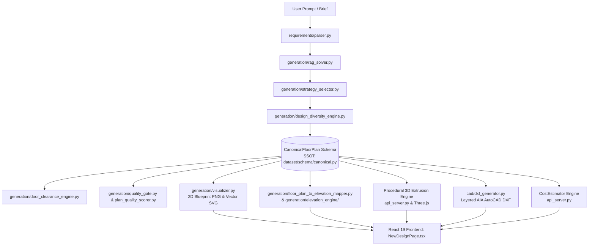
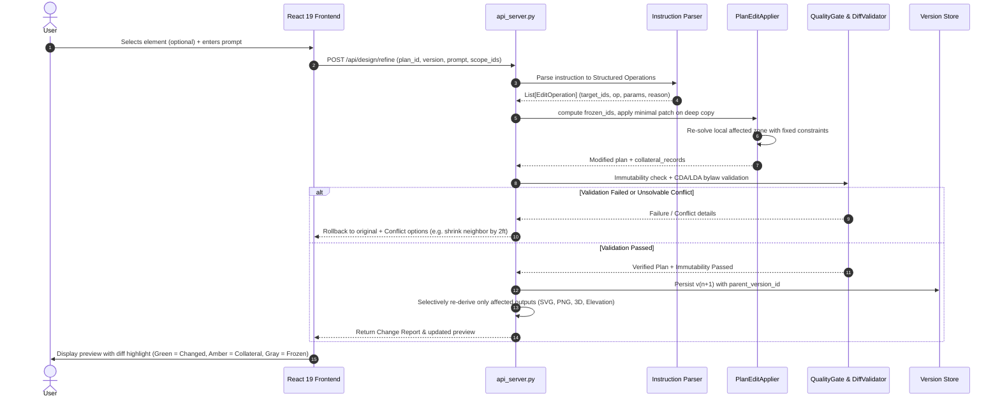

# Refine & Regenerate Architecture Specification
**ArchiCraft AI — Targeted Parametric Editing & Minimal Patch Pipeline**
*Document Version: 1.0.0 | Date: 2026-11-04 | Target: Production-Grade Implementation*

---

## 1. Executive Summary & Core Principle

In residential architectural CAD, modifying a generated floor plan must **never re-synthesize or re-randomize the entire house layout**. When a client asks to:
> *"make the master bedroom bigger"*, *"move the kitchen to the rear right"*, or *"add a powder room under the stairs"*

the system must alter **only those targeted elements**. Every other room polygon, interior partition, door location, window placement, stair riser, elevation feature, and 3D coordinate must remain **byte-for-byte and coordinate-for-coordinate invariant**.

This document outlines the pipeline survey, the Single Source of Truth (SSOT), dependency graph of derived outputs, and the technical implementation plan for **Refine** (targeted instruction-driven edits) and **Regenerate** (scoped alternative re-solving).

---

## 2. Repo Pipeline & Architecture Survey

We mapped the full generation and presentation pipeline across `api_server.py`, the `generation/` modules, and the React 19 frontend:



### Module Responsibilities:
1. **Requirements Parser** (`requirements/parser.py`): Parses user natural language briefs into dimensional envelopes and room counts.
2. **Floor Plan Solvers** (`generation/rag_solver.py`, `generation/design_diversity_engine.py`, `generation/strategy_selector.py`): Retrieve Pakistani CAD archetypes from `dataset/extracted_vector_knowledge` (85+ ground-truth CV plans) and scale them parametrically to plot dimensions.
3. **Canonical Floor Plan Schema** (`dataset/schema/canonical.py`): The foundational data model holding typed `rooms`, `walls`, `openings`, `boundary`, and `metadata`.
4. **Door Clearance & Quality Gate** (`generation/door_clearance_engine.py`, `generation/quality_gate.py`, `generation/plan_quality_scorer.py`): Validates door swing arcs, wall cutouts, room aspect ratios, OTS natural light ventilation, and CDA/LDA bylaw setbacks.
5. **Visualizer** (`generation/visualizer.py`): Renders 1:100 scale publication blueprints with double-line poché walls, furniture blocks, stair treads, door swings, and dimension chains.
6. **Elevation Engine** (`generation/floor_plan_to_elevation_mapper.py` & `generation/elevation_engine/`): Projects 2D plan openings, bays, stair mumty cores, and porches into coordinated front elevations with distinct style treatments (Modern, Spanish, Classical, Minimalist).
7. **3D Mesh & Blender Solid Modeling** (`ProceduralArchitecturalEngine._generate_3d_geometry`): Generates LOD-300 wireframe/mesh volumes for Three.js rendering and procedural `.blend` scene construction.
8. **AutoCAD DXF Exporter** (`cad/dxf_generator.py`): Emits industry-standard AIA layered CAD files (`A-WALL-EXTR`, `A-DOOR`, `A-GLAZ`, etc.).
9. **BOQ & Cost Estimator** (`CostEstimator` in `api_server.py`): Dynamic construction estimation based on covered area, room schedules, and structural tiers.
10. **Frontend Viewport** (`frontend/src/pages/designs/NewDesignPage.tsx` & `ArchitecturalPlanCanvas.tsx`): React 19 interactive pan/zoom canvas, elevation viewer, 3D viewport, and export triggers.

---

## 3. Single Source of Truth (SSOT) & Derived Outputs Map

### 3.1 The Single Source of Truth
The **canonical design state** is represented by `CanonicalFloorPlan` (`dataset/schema/canonical.py`), serialized into `output/{plan_id}/v{version}/plan.json`:

```json
{
  "version": 1,
  "plan_id": "archi_35x65_modern_1",
  "project_title": "10 Marla Modern Residence (35'x65')",
  "canonical_plan": {
    "metadata": {
      "plan_id": "archi_35x65_modern_1",
      "levels": [0, 1],
      "wall_height_m": 3.05,
      "scale_px_to_m": 0.05
    },
    "boundary": [[0.0, 0.0], [10.67, 0.0], [10.67, 19.81], [0.0, 19.81], [0.0, 0.0]],
    "total_area_m2": 211.37,
    "rooms": [
      {
        "room_id": "r_porch_0",
        "room_type": "garage",
        "room_name": "Car Porch (2 Cars)",
        "polygon": [[0.0, 0.0], [6.1, 0.0], [6.1, 5.5], [0.0, 5.5], [0.0, 0.0]],
        "area_m2": 33.55,
        "centroid": [3.05, 2.75],
        "level_index": 0,
        "is_habitable": false,
        "metadata": { "bay": "front", "canopy": true }
      }
    ],
    "walls": [ ... ],
    "openings": [ ... ],
    "graph_edges": [ ... ]
  },
  "plot": { "width_ft": 35.0, "length_ft": 65.0 },
  "style": "modern_contemporary"
}
```

### 3.2 Derived Output Dependency Matrix

Every derived output is a deterministic function of specific sub-components of `CanonicalFloorPlan`:

| Derived Output | Dependent SSOT Properties | Does NOT Depend On | Selective Recomputation Trigger |
| :--- | :--- | :--- | :--- |
| **2D Blueprint PNG/SVG** | `rooms.polygon`, `walls`, `openings`, `metadata` | Elevation style, facade materials | Any room boundary, door, or window change |
| **Front Elevation SVG/PNG** | Front-facing `openings`, front wall bays, front roof profile, stair mumty `[min_x, max_x]`, architectural style | Interior doors, rear bathrooms, kitchen layout, interior finishes | Changes to front boundary, front rooms, porch, stair horizontal position, or facade style |
| **3D Three.js Mesh / OBJ** | `rooms.polygon`, wall height, `levels`, roof slab coordinates | Furniture blocks, 2D dimension chains, drawing annotations | Any structural wall, floor level, or room polygon edit |
| **AutoCAD DXF** | Complete `walls`, `openings`, `rooms`, `boundary` | Render colors, shadow textures | Structural or opening changes |
| **BOQ Cost Estimate** | Total covered area ($m^2$), room counts (`bedroom`, `bathroom`), budget tier | Exact (x, y) coordinates, door swing directions, window sill heights | Changes to room area, room count, or story count |

---

## 4. Refine vs. Regenerate: Definitions & Contracts

### 4.1 Refine
* **Contract**: The user enters an instruction in plain language (e.g. *"Enlarge master bed by 20%"*, *"Move kitchen to rear OTS"*, *"Add attached powder bath to drawing room"*, *"Kitchen ko thora bara kar do"*).
* **Execution**:
  1. Instruction is parsed into a **strictly validated list of edit operations** (`EditOperation`).
  2. All non-targeted elements are tagged as `frozen_ids`.
  3. Edit operations are applied to a deep copy of the active version.
  4. Only affected local zones are re-solved. Collateral movement is minimized and explicitly reported.
  5. Immutability validation asserts frozen elements are bit-for-bit invariant.
  6. A new immutable version ($v_{n+1}$) is persisted with parent pointer $v_n$.

### 4.2 Regenerate
* **Contract**: The user selects a **specific scope** (e.g. Room `r_bed_1`, the Front Elevation, the Kitchen Suite, the Stair Core, or explicitly "Entire Plan") and requests a fresh alternative.
* **Execution**:
  1. Default scope is **narrowest selection** (the currently selected element).
  2. Elements outside the chosen scope are frozen.
  3. The local solver re-proposes 1 to 3 topological layout options **for that scope only**, keeping all surrounding boundary walls and connected rooms static.
  4. User previews options side-by-side with color-coded diff highlights before committing.

---

## 5. Technical Architecture: The 6-Stage Patch Pipeline



### Stage 1: Structured Operation Schema & LLM Instruction Parser
- **New Module**: `generation/edit_operation_schema.py`
  - Validated Pydantic models for every operation type:
    - `ResizeRoomOp`: `room_id`, `scale_factor` or `target_dimensions_ft`, `direction`
    - `MoveRoomOp`: `room_id`, `target_zone` (`front`, `middle`, `rear`, `left`, `right`)
    - `SwapRoomsOp`: `room_id_a`, `room_id_b`
    - `AddRoomOp`: `room_type`, `target_zone`, `attached_to_id`, `dimensions_ft`
    - `RemoveRoomOp`: `room_id`, `merge_into_id`
    - `AddDoorOp` / `MoveDoorOp` / `RemoveDoorOp`: `opening_id`, `wall_id`, `position`
    - `AddWindowOp` / `MoveWindowOp`: `opening_id`, `wall_id`, `sill_height`
    - `ChangeStairTypeOp`: `stair_type` (`dog_leg_u`, `straight_flight`, `l_shape`)
    - `ChangeElevationStyleOp`: `style` (`modern`, `spanish`, `classical`, `minimalist`)
- **New Module**: `generation/instruction_to_operations_parser.py`
  - Sends the current plan element catalog (ids, names, categories, coordinates) + user prompt to LLM (`GeminiService` / Anthropic client wrapper).
  - The LLM **never** generates geometric designs; it is strictly prompted to map English/Urdu text to `List[EditOperation]` referencing existing ids.
  - Includes deterministic rule-based regex fallback (`ImprovementParser`) for offline or low-latency operations and colloquial Pakistani phrasing (*"kitchen ko bara kar do"*, *"drawing powder bath add karo"*).
  - Ambiguity Guard: If a prompt references "bedroom" when multiple bedrooms exist, returns:
    `{"status": "clarification_needed", "candidates": [{"id": "r_bed_1", "name": "Master Bed"}, {"id": "r_bed_2", "name": "Guest Bed"}]}`.

### Stage 2: Freeze Engine (`frozen_ids`)
- `frozen_ids = all_element_ids - set(operation.target_ids)`
- Every frozen room polygon, wall segment, door, window, and fixture has its coordinates preserved down to floating-point exactness.

### Stage 3: Minimal Patch Applier & Local Constraint Solver
- Operates on a deep copy (`copy.deepcopy(canonical_plan)`).
- Enlarging or moving a room calculates the minimal boundary delta:
  - If expanding into open setbacks or courtyard: **Zero collateral**.
  - If sharing an interior partition with a neighboring room: Pushes the shared wall and explicitly tags the affected neighbor with `{"id": "neighbor_id", "reason": "shared wall shifted by Δx"}`.
  - If moving a room forces a violation without collateral space: Aborts and returns a `SpatialConflict` report with actionable choices:
    - Option 1: *"Shrink Store Room by 2 ft"*
    - Option 2: *"Cancel modification"*

### Stage 4: Strict Immutability & Bylaw Quality Gate
- **New Module**: `generation/plan_immutability_validator.py`
  - Computes a mathematical deep-diff between $v_n$ and $v_{n+1}$:
    $$\forall e \in \text{frozen\_ids}: \text{polygon}(e)_{v_{n+1}} \equiv \text{polygon}(e)_{v_n}$$
  - Any drift outside `targets + declared_collateral` triggers an **automatic atomic rollback** to $v_n$.
  - Executes `DoorClearanceEngine` to verify doors punch true wall cutouts with clear $90^\circ$ swept arcs.
  - Verifies LDA/CDA minimum habitable bedroom area ($\ge 120\text{ sq ft}$) and bathroom accessibility.

### Stage 5: Selective Recomputation of Dependent Outputs
- Computes dirty flags:
  - `floor_plan_dirty`: true if room boundaries, walls, or openings changed.
  - `elevation_dirty`: true if front facade walls, front openings, stair mumty horizontal bounds, or roof style changed.
  - `mesh_dirty`: true if room footprint or wall heights changed.
  - `boq_dirty`: true if covered area or room count changed.
- If only an interior rear door is moved: `elevation_dirty = false` $\implies$ Elevation PNG/SVG is reused with zero CPU cycles!
- If only elevation style is refined: `floor_plan_dirty = false` $\implies$ Floor plan CAD blueprint remains untouched!

### Stage 6: Version Persistence & Change Report
- Persists to `output/{plan_id}/v{version}/`:
  - `plan.json`: full canonical floor plan, metadata, and parent version link.
  - `change_report.json`:
    ```json
    {
      "version": 2,
      "parent_version": 1,
      "operations_applied": [
        { "op": "RESIZE_ROOM", "target_id": "r_master_bed_0", "params": { "delta_area_sqft": 30.0 } }
      ],
      "changed_ids": ["r_master_bed_0"],
      "collateral_ids": [
        { "id": "r_dressing_0", "reason": "Shared partition wall shifted 0.45m" }
      ],
      "unchanged_count": 46,
      "immutability_check": "passed",
      "warnings": []
    }
    ```

---

## 6. Frontend UI/UX Architecture (React 19)

### 6.1 Refine / Regenerate Floating Inspector Panel
In `NewDesignPage.tsx`:
1. **Mode Switcher Toggle**:
   - `[ Refine (Apply Specific Changes) | Regenerate (Re-solve Scoped Alternative) ]`
2. **Interactive Scope Selection**:
   - Clicking a room, door, or stair core in `ArchitecturalPlanCanvas` or the 3D viewport selects it (`selectedElementIds: string[]`).
   - Breadcrumb displays: `Selected: Master Bedroom (r_master_bed_0)` with a clear button.
   - An explicit button: `[ Select Entire Plan (Global Re-solve) ]`.
3. **Instruction Input & Quick Chips**:
   - Text input with auto-expanding prompt field.
   - Quick chips: `+ Enlarge (+20%)`, `↔ Swap with Dining`, `🚪 Add Exterior Door`, `🚻 Add Attached Bath`, `🪜 Move Stairs to Foyer`.
4. **Interactive Pre-Commit Diff Modal**:
   - Shows the side-by-side or overlay comparison before writing the change to history.
   - **Visual color coding**:
     - 🟩 **Green outline**: Directly modified target elements.
     - 🟨 **Amber outline**: Declared collateral adjustments.
     - ⬜ **Muted/Dimmed**: Frozen, completely untouched regions.
   - Plain English summary list:
     - *"Increased Master Bedroom width from 14'-0" to 16'-0""*
     - *"Adjusted Walk-In Dressing width from 8'-0" to 6'-0" (collateral)"*
   - Actions: `[ Confirm & Apply (v2) ]`, `[ Tweak Prompt ]`, `[ Cancel ]`.
5. **Version History & Immutable Undo/Redo**:
   - Interactive version pills: `v1 (Original)`, `v2 (Master Bed Expanded)`, `v3 (Spanish Facade)`.
   - Native Undo (`Ctrl+Z`) and Redo (`Ctrl+Y`) switching instantaneous design state without page reloads.

---

## 7. Implementation Roadmap & Milestones

Following the user's execution instructions, no code will be written until this document is reviewed and approved. Upon approval, execution will proceed in strict order:

1. **Step 1 (Backend Core & Operations Schema)**:
   - Create `generation/edit_operation_schema.py` (Pydantic models for all 14 edit ops).
   - Create `generation/instruction_to_operations_parser.py` (LLM + Urdu/English rule-based parser).
   - Create `generation/plan_immutability_validator.py` (Deep-diff and mathematical invariance checks).
   - Enhance `generation/plan_edit_applier.py` (Selective local constraint solver and collateral tracker).
2. **Step 2 (Automated Test Suite)**:
   - Create `tests/test_refine_regenerate.py` covering all required test matrices:
     - 10 sample plans immutability verification.
     - Each operation type tested in isolation.
     - Ambiguity test (clarification returned).
     - Conflict test (rollback + options).
     - Rollback test on validator failure.
     - Dependency test (interior edit leaves elevation unchanged; elevation edit leaves plan unchanged).
     - Undo/redo round-trip test.
     - 15 realistic natural language prompts (including Urdu-English mixed).
3. **Step 3 (API Endpoints in `api_server.py`)**:
   - Implement `POST /api/design/refine` and `POST /api/design/regenerate`.
   - Add selective re-derivation flags for PNG, SVG, DXF, 3D, and BOQ.
4. **Step 4 (Frontend UI in `frontend/src/`)**:
   - Add interactive selection to `ArchitecturalPlanCanvas.tsx`.
   - Build `RefineRegeneratePanel.tsx` and `DiffPreviewModal.tsx`.
   - Wire version tree and undo/redo into `NewDesignPage.tsx`.
5. **Step 5 (End-to-End Verification)**:
   - Run full automated test suite and Playwright browser integration test.
   - Verify that refining one room leaves all other rooms and derived outputs bit-for-bit identical.

